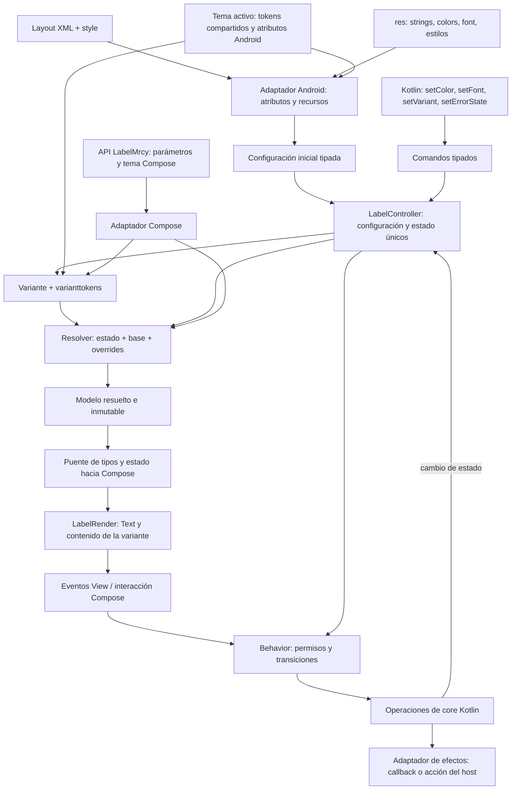

# Propuesta: componentes XML con variantes, comportamiento y tokens compartidos

Fecha: 20 de octubre de 2026. Estado: propuesta de diseño; no implementada.

Todos los nombres nuevos, atributos, setters y recursos de los ejemplos describen la API objetivo. No pueden copiarse todavía al proyecto esperando que funcionen. Los imports y parte del código de infraestructura se omiten para explicar el contrato.

## 1. Decisión recomendada

Mantener inicialmente `LabelWrp` como fachada Android sobre el render Compose, extraer las reglas compartidas a un núcleo Kotlin y añadir una capa Android que resuelva recursos, estilos y setters. XML y Kotlin deben actualizar la misma configuración del wrapper; Compose solo observa su resultado y devuelve eventos.

Separar responsabilidades significa que el núcleo no depende de Compose y que los atributos XML no se resuelven en una función composable. El renderer puede seguir siendo Compose. Así se reutilizan los componentes existentes sin crear de entrada dos implementaciones visuales.

`LabelWrp` será compatible con un conjunto explícito de capacidades de texto. Hoy hereda de `AbstractComposeView`, no de `TextView`: ser una View Android no le proporciona todos los métodos de un TextView. Si el requisito futuro fuera compatibilidad completa con su herencia, selección de texto, spans y otras APIs, habría que evaluar una fachada basada en `AppCompatTextView` y un segundo renderer. Esa alternativa tiene un coste adicional de paridad y no es necesaria para ofrecer los atributos y setters de esta propuesta.

## 2. Responsabilidades

| Capa | Qué decide | Qué recibe y entrega |
|---|---|---|
| `variant` | Identidad y contenido por defecto: `Default`, `Optional`, etc. | Variante → receta semántica. |
| `varianttokens` | Apariencia base de cada variante para los estados admitidos. | Receta + tema → tokens base. |
| `state` | Situación actual: habilitado, error, foco y presión cuando correspondan. | Datos explícitos; no colores. |
| `behavior` | Acciones permitidas, transiciones y operaciones de `core` que debe solicitar. | Evento + estado + capacidades → siguiente estado y efectos. |
| `core` | Contratos y funciones básicas compartidas: actualización, selección de estado, combinación de parches y reglas puras. | Kotlin sin `Context`, `Modifier` ni `@Composable`. |
| Adaptación Android | Atributos, estilos, recursos, tema Android, listeners y ciclo de vida de la View. | XML/setters → configuración tipada para el núcleo. |
| Resolución visual | Combina tema, variante, estado y personalizaciones. | Configuración → modelo de render resuelto. |
| Adaptación y `render` Compose | Conversión a tipos Compose y representación visual. | Modelo resuelto → UI; interacción → evento. |

`setColor` y `setFont` modifican apariencia; no pertenecen a `behavior`. `behavior` puede invocar operaciones de `core`, como `requestActivation` o una transición de carga, pero no cargar fuentes ni modificar colores para expresar estados. El resolver visual interpreta el estado resultante.

Para un label pasivo, el comportamiento mínimo solo conserva estado y semántica. Si se registra un click, se habilita esa capacidad. No se introduce validación ni estado de edición en un componente de texto de solo lectura.

## 3. Flujo de datos



Las flechas describen flujo de datos y eventos, no imports. `core` nunca importa el wrapper ni Compose. El ciclo de interacción solo se ejecuta ante un evento; renderizar no vuelve a emitir setters.

En la entrada XML, `LabelController` pertenece a una instancia de View. En Compose directo, el estado puede ser propiedad del consumidor; se reutilizan resolvers y reglas, sin imponerle el controlador mutable de una View. Ambas entradas terminan en el mismo `LabelRender` interno. El wrapper no debe llamar a un entrypoint que vuelva a resolver y sustituir los valores ya calculados.

## 4. Tema y recursos: una fuente compartida

La base inicial serán los tokens existentes: `LibraryColorTokens`, `CorporateTypography`, `TypographyToken` y las familias corporativas. Un proveedor Kotlin devolverá una instantánea explícita del tema, en lugar de exigir `CompositionLocal` para obtenerla.

Un `AndroidThemeBridge` combinará esa base con los atributos Android que el host configure. Un adaptador Compose publicará el mismo resultado en los locals del sistema. Se conservarán `MyLibraryThemeWrp` y `MyLibraryTheme` como entradas, trasladando la selección común a este proveedor. Si cambia la marca o el modo, ambos deben actualizar su instantánea a partir de la misma configuración.

Los roles XML nuevos, por ejemplo `?attr/mrcyColorText`, `?attr/mrcyColorError` y `?attr/mrcyTextAppearanceLabel`, tendrán un mapeo explícito hacia los roles del tema. Cuando no se proporcionen, se usará la base Kotlin. No se crearán dos catálogos manuales con los mismos valores. Si más adelante se exportan todos los tokens a XML, la generación deberá partir de una fuente canónica y verificarse en build.

Se reutilizarán los archivos de `res/font/`, `@string`, `@color` y los estilos del host. `@color/...` identifica un recurso concreto; `?attr/...` expresa una selección del tema. Un recurso de color no cambia automáticamente cuando cambia un tema corporativo en memoria: el puente debe resolver el atributo o rol correspondiente.

Las referencias Android permanecerán en la capa Android. El núcleo recibirá colores, métricas y claves semánticas resueltas, sin identificadores `R.*`. Para fuentes se usará un identificador opaco en el contrato y una tabla de resolución por instancia/tema en el adaptador; los objetos `Typeface`/`FontFamily` quedan en los adaptadores. Se ampliará así el enum actual sin introducir tipos Compose en `core`.

El resolver Android conservará el origen de recursos y roles cuando sea necesario para recalcularlos. `TypedArray` resuelve valores, pero no es un modelo persistente del tema: se recicla y no se almacena. Ante recreación se vuelve a leer XML; si el host cambia tema sin recrear, debe reenviar configuración a través del puente y conservar una descripción reconstruible de estilos/atributos, o reinflar la vista. No se promete que una copia ARGB congelada siga un tema dinámico.

## 5. Variantes, estado y behavior

### Variantes iniciales

| Variante | Contenido por defecto | Apariencia base |
|---|---|---|
| `Default` | Texto del consumidor; vacío si no se proporciona. | Rol tipográfico `label` y colores del tema. |
| `Optional` | Recurso traducible `@string/mrcy_label_optional`. | Rol `caption` y receta de la variante. |

Una receta fija define qué roles usar; los valores efectivos pueden variar por tema. No significa hacer inmutables todos los colores o tamaños.

Un texto explícito, incluso vacío, sustituye el contenido por defecto. Cambiar la variante conserva las personalizaciones explícitas; `clearTextOverride()` recupera el contenido de la variante cuando no haya texto XML explícito. El comportamiento actual de `optionalText`, que agrega un texto secundario, se migrará mediante composición de un label principal y uno `Optional`; no debe reinterpretarse silenciosamente como cambio del texto principal.

### Estado mínimo

```kotlin
// Contrato conceptual del núcleo.
data class LabelState(
    val enabled: Boolean = true,
    val error: Boolean = false,
)

fun canActivate(state: LabelState, hasClickHandler: Boolean): Boolean =
    state.enabled && hasClickHandler
```

`Default` puede estar habilitado, deshabilitado o en error. `Optional` también. No se crean variantes `DefaultDisabled`, `OptionalError`, etc.

Decisión propuesta para la apariencia base: `disabled > error > normal`. La coexistencia `enabled=false, error=true` conserva ambos datos y su descripción accesible; el estilo base usa disabled. Esta prioridad es propia de Maracuya, no una regla universal de Android ni una conclusión de un paper.

`setEnabled(false)` sincroniza la View y el estado consumido por Compose. `behavior` rechaza la activación, el renderer no expone una acción habilitada y `performClick()` no debe despachar el listener. Un único adaptador despacha el callback una vez; no se ejecuta simultáneamente desde Compose y desde la View.

`setErrorState(true)` representa un error que el host comunica; un label no valida por sí mismo el contenido del formulario. En componentes con carga, contraseña o edición se añadirán capacidades y transiciones específicas, reutilizando las operaciones pertinentes de `core`.

## 6. Precedencia y overrides

### Resolución XML

Para cada atributo se usará `obtainStyledAttributes(attrs, styleable, defStyleAttr, defStyleRes)`, también cuando `attrs == null`:

```text
atributo local XML
  > style del elemento
  > estilo señalado por mrcyLabelStyle
    (o defStyleRes si ese atributo no se resuelve)
  > valor del tema Android
```

Esta prioridad procede del [contrato de Resources.Theme](https://developer.android.com/reference/android/content/res/Resources.Theme). `defStyleAttr` y `defStyleRes` no son dos capas de estilos que siempre se combinan.

El estilo base de la biblioteca declarará la variante por defecto, pero no rellenará todos los campos con colores/tipografía concretos: los valores ausentes deben permitir que actúen `varianttokens` y el tema compartido.

`TextAppearance` se expandirá como un parche de propiedades tipográficas; los atributos de texto específicos ya resueltos prevalecerán sobre sus campos. Debe documentarse qué propiedades se admiten. En el primer prototipo: tamaño, familia, peso/estilo, altura de línea y espaciado, además del color cuando el estilo lo incluya. Los formatos y unidades Android se convertirán en el adaptador, respetando escalado de fuente; no se mezclarán píxeles, `sp` y espaciado en `em` sin conversión.

### Resolución del componente

```text
por cada propiedad y estado:
  parche Kotlin de esta instancia
  > parche XML resuelto
  > tokens de la variante para el estado
  > fallback documentado de la biblioteca
```

Los parches son dispersos: una propiedad ausente no reemplaza su base. Dentro de un parche, un color específico del estado tiene prioridad sobre el color general. El adaptador transforma el selector Android en un valor para el estado actual sin llevar `ColorStateList` al núcleo puro.

`android:textColor`, `setColor(@ColorRes)` y `setTextColor(@ColorInt)` representan un color general o una lista de estados. Un color sólido explícito cubre todos los estados, coherente con `TextView`, salvo un override específico que tenga prioridad según las reglas anteriores. Eso no modifica `enabled`, `error` ni los permisos de interacción. Para personalizar solamente el estado normal se usará `foregroundDefault` en el override tipado. Para XML con colores distintos por estado se usará un selector.

Los setters modifican únicamente su campo del parche Kotlin; no capturan una copia completa de los tokens base. La última escritura al mismo campo prevalece. `setTokensOverride()` combina solo campos presentes con ese parche; un `null` significa «no modificar». `clearColorOverride()` elimina sus entradas de color Kotlin; `clearOverrides()` elimina el parche visual Kotlin completo y vuelve a revelar el XML y la variante. No borra texto, estado ni selección de variante.

Un cambio de tema o variante recalcula la base y conserva las personalizaciones. Los overrides que referencian roles siguen el tema; los que contienen valores concretos conservan esos valores.

## 7. API pública objetivo

El namespace `android:` está reservado al framework. El ejemplo correcto es `android:textColor="@color/..."`; no existe `android:setColor`. Los atributos Maracuya usan `app:`.

| Atributo XML | API Kotlin propuesta | Semántica |
|---|---|---|
| `android:text` | `setText(@StringRes Int)` y propiedad `text` | Texto explícito; el recurso permite localización. |
| `app:mrcyLabelVariant` | `setVariant(LabelVariant)` | Si se omite, `Default`. |
| `android:textColor` | `setColor(@ColorRes Int)` | Recurso de color sólido o selector. |
| `android:textColor` | `setTextColor(@ColorInt Int)` / `setTextColor(ColorStateList)` | Alternativas para valores ya cargados; no reciben un `R.color` en la sobrecarga ARGB. |
| `android:fontFamily` | `setFont(@FontRes Int)` | Fuente o familia de recursos; resolver en adaptador Android. |
| `android:textSize` | `setTextSizeSp(Float)` | Tamaño escalable, unidad explícita. |
| `android:textAppearance` | `setTextAppearance(@StyleRes Int)` | Parche tipográfico reutilizable. |
| `app:mrcyTypography` | `setTypography(TypographyRole)` | Selecciona un rol del tema, como `Label` o `Caption`. |
| `android:enabled` | `setEnabled(Boolean)` / `isEnabled` | Estado funcional y visual sincronizado. |
| `app:mrcyError` | `setErrorState(Boolean)` / propiedad existente `error` | Estado de error, independiente de la variante. |
| `android:contentDescription` | `setContentDescription(CharSequence?)` | Semántica accesible, sin duplicar nodos entre View y Compose. |
| `android:maxLines` | `setMaxLines(Int)` | Límite de líneas; validar valores positivos. |
| `android:ellipsize` | `setEllipsize(TextUtils.TruncateAt?)` | Primer alcance: sin elipsis o `END`; otros modos requieren soporte explícito. |
| `style` | Combinación de setters anteriores | Estilo de construcción; no se inventa un `setStyle` universal. |
| Sin equivalente único | `setColorRole(ColorRole)` | Color general tomado del tema activo. |
| Sin equivalente único | `setTokensOverride(LabelStyleOverride)` | Override parcial tipado, sin registry. |

`setColor` es una comodidad nueva de Maracuya. Se separa de `setTextColor` porque `@ColorRes` y `@ColorInt` son ambos `Int`; las anotaciones no crean sobrecargas diferentes. La distinción evita interpretar un ID como ARGB. [Contrato de TextView](https://developer.android.com/reference/android/widget/TextView).

`app:mrcyTypography` establece el rol base; `setTypography` sustituye esa selección de rol, conservando las personalizaciones XML y Kotlin. Elegir un rol no equivale a escribir todos sus campos como overrides. Esto permite elegir `Caption` y cambiar únicamente su fuente.

Para eliminar ambigüedad temporal, `setTextAppearance` escribe en el parche Kotlin los campos presentes en el estilo resuelto, incluidos los heredados. Así, `setFont(A); setTextAppearance(B)` usa la fuente de B si B define familia; si no la define, conserva A. La secuencia inversa conserva A. Un `setTypography(Caption)` posterior cambia la base, pero conserva esos campos explícitos. `clearTypographyOverrides()` elimina los campos tipográficos Kotlin y conserva el rol seleccionado; la configuración XML vuelve a tener efecto. Para observar el rol sin personalizaciones, tampoco debe haber atributos tipográficos explícitos en XML. El color incluido en un `TextAppearance` escribe el campo de color general y obedece su misma prioridad.

Las capacidades se compartirán mediante interfaces pequeñas como `TextColorConfigurable`, `FontConfigurable` y un delegado de estilo. No mediante una superclase que obligue a botones, inputs e iconos a implementar APIs que no les corresponden. `getters` y propiedades consultarán la misma configuración efectiva, no caches independientes.

### Declaración mínima propuesta en attrs.xml

```xml
<resources>
    <attr name="mrcyLabelStyle" format="reference" />
    <attr name="mrcy_state_error" format="boolean" />

    <declare-styleable name="LabelWrp">
        <attr name="android:text" />
        <attr name="android:textColor" />
        <attr name="android:fontFamily" />
        <attr name="android:textSize" />
        <attr name="android:textAppearance" />
        <attr name="android:enabled" />
        <attr name="android:contentDescription" />
        <attr name="android:maxLines" />
        <attr name="android:ellipsize" />
        <attr name="mrcyLabelVariant">
            <enum name="default" value="0" />
            <enum name="optional" value="1" />
        </attr>
        <attr name="mrcyTypography">
            <enum name="label" value="0" />
            <enum name="caption" value="1" />
        </attr>
        <attr name="mrcyError" format="boolean" />
    </declare-styleable>
</resources>
```

Este fragmento sustituye conceptualmente el contrato actual; no se añadirá como un segundo `declare-styleable` incompatible. La migración mantendrá los atributos anteriores mediante aliases controlados.

## 8. Ejemplos de uso

### Variante por defecto

```xml
<cruxui.android.maracuya.wrappers.components.labels.LabelWrp
    xmlns:android="http://schemas.android.com/apk/res/android"
    android:id="@+id/nombreLabel"
    android:layout_width="wrap_content"
    android:layout_height="wrap_content"
    android:text="@string/nombre_completo" />
```

No requiere registrar funciones ni construir tokens. Usa `Default`, su rol tipográfico y el tema activo.

### Apariencia personalizada desde XML

```xml
<cruxui.android.maracuya.wrappers.components.labels.LabelWrp
    xmlns:android="http://schemas.android.com/apk/res/android"
    xmlns:app="http://schemas.android.com/apk/res-auto"
    android:id="@+id/nombreLabel"
    android:layout_width="wrap_content"
    android:layout_height="wrap_content"
    android:text="@string/nombre_completo"
    android:textColor="@color/label_nombre_estados"
    android:fontFamily="@font/mulish_regular"
    android:textSize="16sp"
    android:maxLines="2"
    android:ellipsize="end"
    android:enabled="true"
    app:mrcyLabelVariant="default"
    app:mrcyError="false" />
```

`res/color/label_nombre_estados.xml`, con recursos de color del tema/app definidos por el consumidor:

```xml
<selector xmlns:android="http://schemas.android.com/apk/res/android"
    xmlns:app="http://schemas.android.com/apk/res-auto">
    <item android:state_enabled="false"
        android:color="@color/label_disabled" />
    <item app:mrcy_state_error="true"
        android:color="@color/label_error" />
    <item android:color="@color/label_normal" />
</selector>
```

El wrapper expone `mrcy_state_error` en su drawable state mediante `onCreateDrawableState`/`mergeDrawableStates`. Al cambiar error ejecuta `refreshDrawableState` y el adaptador vuelve a evaluar el selector para el render. `ColorStateList` conserva el orden de coincidencia; el ejemplo prioriza disabled. Esta mecánica debe probarse tanto con estado inicial XML como con cambios Kotlin. [ColorStateList](https://developer.android.com/reference/android/content/res/ColorStateList).

El primer prototipo soportará selectores de `state_enabled` y `mrcy_state_error`. Los estados `pressed`, `focused` y `selected` requieren un puente explícito entre las interacciones Compose y el estado de la View antes de ofrecerlos. No se asumirá que pulsar un `Text` Compose modifica automáticamente el drawable state del wrapper.

### Label predefinido «Opcional»

```xml
<cruxui.android.maracuya.wrappers.components.labels.LabelWrp
    xmlns:android="http://schemas.android.com/apk/res/android"
    xmlns:app="http://schemas.android.com/apk/res-auto"
    android:layout_width="wrap_content"
    android:layout_height="wrap_content"
    app:mrcyLabelVariant="optional" />
```

Su contenido proviene de un recurso traducible de la biblioteca. No hace falta repetir «Opcional» en el layout ni introducir una función de registro.

### Estilo reutilizable

```xml
<resources>
    <style name="Widget.MiApp.LabelNombre" parent="">
        <item name="mrcyLabelVariant">default</item>
        <item name="android:textColor">@color/label_nombre_estados</item>
        <item name="android:fontFamily">@font/mulish_regular</item>
        <item name="android:textSize">16sp</item>
    </style>
</resources>
```

Se aplica con `style="@style/Widget.MiApp.LabelNombre"`. El tema también podrá asignarlo al atributo `mrcyLabelStyle`. Un recurso `TextAppearance` se usa para compartir solo apariencia textual; un estilo de widget puede incluir además variante y otras propiedades.

### Las mismas capacidades desde Kotlin

```kotlin
val label = findViewById<LabelWrp>(R.id.nombreLabel)

label.setText(R.string.nombre_completo)
label.setVariant(LabelVariant.Default)
label.setColor(R.color.label_nombre_estados)
label.setFont(R.font.mulish_regular)
label.setTextSizeSp(16f)
label.setMaxLines(2)
label.setErrorState(true)
label.isEnabled = false
```

`setColor(R.color.label_normal)` también será válido, pero aplica un color sólido a todos los estados. Un selector conserva una política de colores diferenciada. `setTextColor(0xFF123456.toInt())` recibe un ARGB ya resuelto.

Para personalizar solo algunos tokens con valores del tema:

```kotlin
label.setTokensOverride(
    LabelStyleOverride(
        foregroundDefault = ColorValue.Role(ColorRole.TextPrimary),
        foregroundError = ColorValue.Role(ColorRole.Error),
        typography = TypographyValue.Role(TypographyRole.Caption),
    )
)

label.clearColorOverride() // Vuelve al color definido por XML o por la variante.
```

`ColorValue.Role` y `TypographyValue.Role` son referencias tipadas que el proveedor vuelve a evaluar al cambiar tema. El contrato también admitirá valores concretos de los modelos actuales. No se necesita leer `LocalLibraryColorTokens` desde una Activity para personalizar un wrapper.

## 9. Organización propuesta

Estructura conceptual dentro de la biblioteca; comenzar con paquetes, sin crear un módulo Gradle por cada clase:

```text
core/
  text/              contratos y combinación de configuración textual
  labels/
    variant/         LabelVariant y recetas
    varianttokens/   tokens base por variante
    state/           LabelState, eventos y transiciones
    behavior/        permisos y coordinación de operaciones
    resolver/        resolución pura por entradas explícitas
  theme/             contrato de tema y roles compartidos

wrappers/
  core/
    resources/       ColorStateList, fuentes, textos y unidades Android
    theme/           AndroidThemeBridge
    text/            delegado compartido de atributos y setters
  components/labels/
    LabelWrp.kt
    LabelAttributeReader.kt
    LabelController.kt

ui/components/labels/
  LabelMrcy.kt        API Compose
  render/            LabelRender y adaptación final

res/
  layout/
  values/            attrs, strings, styles y recursos de tema necesarios
  color/             selectores
  font/              archivos existentes y familias
```

`LabelController` mantiene entradas Android, parches y estado de su instancia. Las funciones puras se extraen a `core`; las clases de Android permanecen en `wrappers`. El puente observable a Compose se implementa en el borde con estado Compose o un flujo observado según lifecycle; no obliga a meter `mutableStateOf` en el núcleo.

## 10. Qué reutilizar y qué cambiar del proyecto actual

| Evidencia local | Tratamiento propuesto |
|---|---|
| `LabelTokens` y `LabelTokensOverride` | Conservar su semántica de override parcial; añadir estado disabled y referencias adaptables donde haga falta. |
| `LabelTokensResolver` | Extraer combinación y selección puras; dejar lectura de locals en el adaptador Compose. |
| `LabelBehavior` y `LabelBehaviorResolver` | Existen pero no están conectados al render actual; integrar un contrato mínimo de interacción y estado. |
| `LabelAttributeParser` | Leer atributos estándar y estilo por defecto incluso sin `AttributeSet`. |
| `LabelTokensOverrideRegistry` | Mantener temporalmente como compatibilidad de menor prioridad que la API explícita nueva; retirarlo gradualmente. |
| `res/font/` y tokens corporativos | Reutilizar; extender el puente para fuentes arbitrarias sin convertir toda la biblioteca en tipos Compose. |
| `core` dispersos de navegación | Auditar: algunos son Kotlin puro y otros contienen `Modifier`, `Dp` o `Shape`; no trasladarlos como si fueran independientes. |
| Behavior de TextField/navegación | Separar reglas de teclado/carga/interacción de `KeyboardType`, `VisualTransformation`, `remember` y animaciones. |

Durante la transición, la prioridad propuesta será: parche Kotlin nuevo > XML nuevo > overrides legacy explícitos > registry legacy > base. Antes de migrar, se verificará con casos reales la combinación con `labelTokens` completos existentes. Si se mezclan ambas APIs, se emitirá un diagnóstico de desarrollo.

No se añadirán métodos Kotlin con una firma JVM ya generada por una propiedad. Por eso se propone `setErrorState(Boolean)` junto a `error`, y `setText(@StringRes Int)` junto a `text: String`. Si posteriormente se desea una API textual `CharSequence` completa, se migrará su contrato de fuente/binario de forma explícita.

`android:background`, padding y medidas del contenedor seguirán bajo responsabilidad de la View y de su layout padre. El color del texto pertenece al renderer. El bridge no aplicará por segunda vez las mismas medidas o fondos. También deberá sincronizar accesibilidad y elegir una estrategia de disposición de composición apropiada al host. [Integración Compose–Views](https://developer.android.com/develop/ui/compose/migrate/interoperability-apis/compose-in-views).

## 11. Fundamento de las decisiones

| Principio documentado | Interpretación para Maracuya | Comprobación propuesta |
|---|---|---|
| Parnas: ocultar decisiones que pueden cambiar. | Recursos, behavior y render tienen contratos separados. | Cambiar la estrategia de fuente no modifica `LabelBehavior`. |
| FODA: distinguir capacidades comunes, opcionales y alternativas. | Compartir texto/color/fuente; declarar variantes y capacidades específicas. | Un label no depende de lógica de contraseña o carga. |
| Harel: representar comportamiento y dimensiones del estado explícitamente. | Variante y estado son independientes; reglas de activación explícitas. | Probar `Optional + error + disabled` sin crear una variante adicional. |
| MaterialTextView: tema y estilos Android. | Usar resolución estándar de atributos como entrada al puente. | Misma propiedad configurada en tema, estilo y layout respeta prioridad. |
| Backpack: tokens públicos para Views y Compose. | Exponer roles y recursos adecuados para cada superficie. | Configuración equivalente produce el mismo modelo de render. |
| Android: holders y flujo de estado. | Una configuración observable por instancia y eventos de retorno. | Un setter no provoca dos estados distintos ni callbacks duplicados. |

Fuentes: [Parnas, texto completo](https://www.cs.lafayette.edu/~gexia/cs301/resources/parnas.html), [FODA, SEI](https://www.sei.cmu.edu/library/feature-oriented-domain-analysis-foda-feasibility-study/), [Harel, PDF del autor](https://www.weizmann.ac.il/math/harel/sites/math.harel/files/users/user50/Statecharts.pdf), [MaterialTextView](https://github.com/material-components/material-components-android/blob/master/lib/java/com/google/android/material/textview/MaterialTextView.java), [Backpack](https://github.com/Skyscanner/backpack-android), [state holders Android](https://developer.android.com/topic/architecture/ui-layer/stateholders).

Los papers aportan principios, no prueban esta arquitectura Android. Los detalles y límites de las fuentes se registran en [fundamentos](../referencias-arquitectura-xml/03-fundamentos-propuesta.md). Las prioridades, nombres de API y combinación concreta de capas son decisiones propuestas para el proyecto.

## 12. Validación antes de generalizar

1. Implementar solo `LabelWrp`: default, optional, texto, fuente, color, error y disabled.
2. Comparar XML y Kotlin equivalentes por modelo resuelto y captura visual.
3. Probar prioridad tema/style/layout/setter, eliminación de override y construcción programática sin attrs.
4. Verificar colores sólidos y selectores, cambio de error/disabled y ausencia de clicks cuando está deshabilitado.
5. Verificar recursos traducidos, fuente escalada, modo oscuro, cambio de marca y reconstrucción del host.
6. Medir coste de inflación y actualización antes de afirmar mejoras de rendimiento.
7. Aplicar el mismo contrato a TextField para comprobar que `behavior` coordina operaciones reales de `core` sin duplicarlas en XML y Compose.

La implementación se considerará lista para extenderse cuando esas comprobaciones validen el contrato; agregar carpetas o clases por sí solo no demuestra mantenibilidad.
