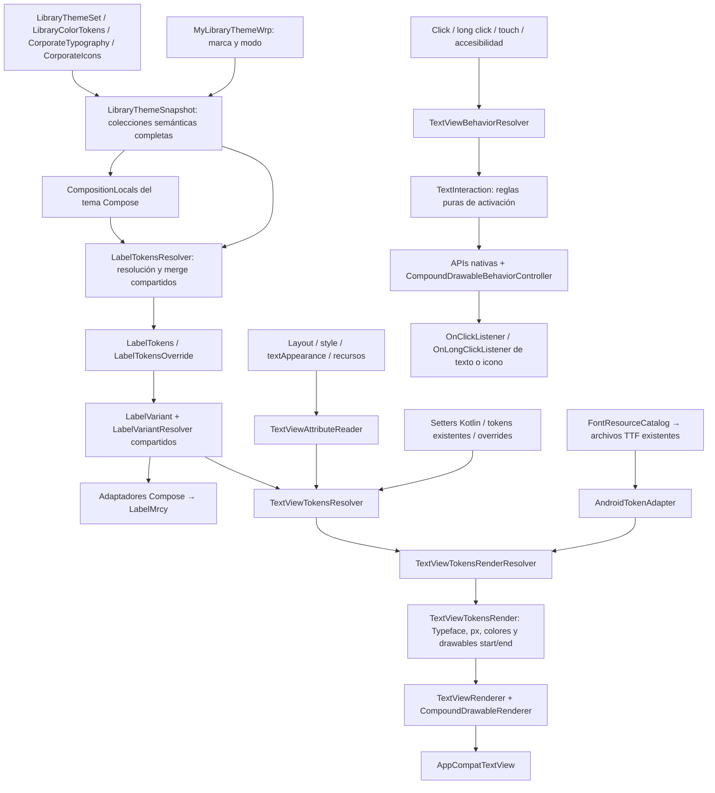

# TextView: semántica compartida con Compose y render Android

Rama: `XMLArchitecture`. Actualización: 20 de octubre de 2026.

El componente público es `cruxui.android.maracuya.wrappers.components.textviews.TextView`, basado en `AppCompatTextView`. Su organización sigue el patrón de los componentes Compose del DS: configuración declarativa, resolvers de variante y behavior, tokens, tokens de render y render final. Las clases semánticas existentes se comparten; la adaptación a ARGB, Typeface, píxeles y Drawable ocurre al final.

Esta revisión reemplaza el primer diseño del documento: se eliminan `AndroidThemeColors`, `AndroidThemeTypography`, la receta duplicada de Label y los XML `mrcy_mulish_family`/`mrcy_davivienda_family`. Los atributos nuevos usan nombres como `error`, `variant`, `iconStart` e `iconEnd`. El antiguo `LabelWrp` sigue disponible como API obsoleta; no se modifican sus atributos legacy.

## Flujo de datos



Los `CompositionLocal` se leen únicamente en el borde Compose. XML llama al overload puro del mismo `LabelTokensResolver`, pasando el snapshot. No necesita abrir una composición para obtener tokens ni mantener un registro de funciones.

## Estructura y responsabilidades

Rutas relativas a `maracuya/src/main/java/cruxui/android/maracuya/wrappers/components/textviews/`:

| Carpeta / archivo | Tipo | Responsabilidad |
|---|---|---|
| `TextView.kt` | Fachada Android / orquestación | Coordina resolvers, conserva las entradas por instancia y expone setters familiares. |
| `attributes/TextViewAttributeReader.kt` | Adaptador XML | Resuelve atributos y estilos Android a entradas tipadas. |
| `core/TextViewDefaults.kt` | Defaults | Centraliza separación predeterminada de iconos. |
| `variant/TextViewVariant.kt` | Variante declarativa | Alias del `LabelVariant` compartido: Default y Optional. |
| `variant/TextViewVariantResolver.kt` | Adaptador de variante | Obtiene el contenido localizado de la receta compartida. |
| `behavior/TextViewBehavior.kt` | Behavior declarativo | Declara listeners y permisos del texto y de cada icono. |
| `behavior/TextViewBehaviorResolver.kt` | Behavior resolver | Consulta las reglas de `core/text` para decidir si una acción está permitida. |
| `tokens/TextViewTokens.kt` | Tokens declarativos | Reutiliza `LabelTokens` mediante alias y declara el resultado semántico de resolución. |
| `tokens/TextViewTokensOverride.kt` | Overrides Android | Expresa recursos, selectores, medidas y personalización independiente de ambos iconos. |
| `tokens/TextViewTokensResolver.kt` | Tokens resolver | Invoca el resolver Label compartido, selecciona la receta y combina XML/Kotlin. |
| `tokensrender/TextViewTokensRender.kt` | Tokens de render | Declara parámetros nativos listos para el renderer. |
| `tokensrender/TextViewTokensRenderResolver.kt` | Render resolver | Convierte semántica y overrides en Typeface, colores, métricas y Drawable. |
| `render/TextViewRenderer.kt` | Render | Aplica los parámetros a la View sin seleccionar nuevas recetas. |

No hay capa `child`: los iconos son compound drawables nativos, no componentes hijos independientes.

Las piezas reutilizables se encuentran fuera del componente:

| Ubicación | Reutilización |
|---|---|
| `ui/components/labels/LabelTokensResolver.kt` | Mismo default y mismo merge para Compose y Views. |
| `ui/components/labels/variant/` | Mismas recetas y selección de tipografía para ambos renderizadores. |
| `theme/LibraryThemeSnapshot.kt` | Paleta, tipografías, iconos y familia completos del DS. |
| `theme/FontResourceCatalog.kt` | Catálogo único de archivos TTF por familia, peso y cursiva. |
| `wrappers/core/resources/AndroidTokenAdapter.kt` | Conversión genérica de tokens DS a valores Android. |
| `wrappers/core/tokens/ViewTokenValues.kt` | Recursos, valores literales y selectores semánticos reutilizables por otras Views. |
| `wrappers/core/render/CompoundDrawableRenderer.kt` | Aplicación y restauración de iconos relativos y tintes. |
| `wrappers/core/behavior/CompoundDrawableBehaviorController.kt` | Touch, long press, RTL, cancelación y acciones accesibles para iconos. |
| `core/text/TextInteraction.kt` | Reglas puras de enabled/error y permiso de activación. |

Para un futuro TextField se conserva esta organización y se reutilizan esas funciones. Solo sus decisiones de variante, edición, validación y teclado necesitan implementación propia. No se copia una segunda paleta o un segundo catálogo de fuentes por componente.

## Tema completo y acceso desde la app anfitriona

`AndroidThemeSnapshot` es un alias de `LibraryThemeSnapshot`; ya no transforma el tema en un subconjunto rígido de cinco colores y tres tipografías. El host puede consultar todas las propiedades semánticas existentes:

```kotlin
val theme = nombre.getThemeTokens()
val color = theme.colors.brandPrimary
val typography = theme.typography.headline24
val icon = theme.icons.alerts.info

nombre.setTypography(typography)
nombre.setIconStart(icon)
nombre.setIconEnd(theme.icons.arrows.navigateNext)
```

Un valor concreto conserva el token elegido. Para reevaluar una selección contra cada nuevo tema se usa un selector tipado, sin registros globales:

```kotlin
import cruxui.android.maracuya.wrappers.components.textviews.tokens.TextViewTokensOverride
import cruxui.android.maracuya.wrappers.core.tokens.TextColor
import cruxui.android.maracuya.wrappers.core.tokens.TextTypography
import cruxui.android.maracuya.wrappers.core.tokens.ViewIcon

nombre.setTokensOverride(TextViewTokensOverride(
    foregroundDefault = TextColor.Semantic { it.brandPrimary },
    typography = TextTypography.Semantic { it.headline24 },
    iconStart = ViewIcon.Semantic { it.alerts.info },
    iconEnd = ViewIcon.Semantic { it.arrows.navigateNext },
))
```

Estos selectores reciben las clases originales `LibraryColorTokens`, `CorporateTypography` y `CorporateIcons`; no limitan sus propiedades a un enum del wrapper. Los roles cortos XML `textColorRole` y `typography` son comodidades del componente, no un catálogo alternativo del DS.

El host también puede reutilizar exactamente los tokens y overrides que recibe el componente Compose:

```kotlin
import cruxui.android.maracuya.ui.components.labels.LabelTokensOverride
import cruxui.android.maracuya.ui.components.labels.LabelTokensResolver

val sharedTokens = LabelTokensResolver.resolve(nombre.getThemeTokens())
nombre.setTokens(sharedTokens)
nombre.setComponentTokensOverride(LabelTokensOverride(
    labelTypography = nombre.getThemeTokens().typography.body2,
    infoIcon = nombre.getThemeTokens().icons.alerts.help,
))
```

`setTokens(null)` vuelve a derivar los tokens del tema. `setComponentTokensOverride(null)` retira la personalización semántica compartida. `setThemeTokens(snapshot)` permite inyectar un snapshot completo por instancia; `null` restaura el tema del host XML más cercano. Un host anidado mantiene su propio alcance.

## Variantes como recetas reutilizables

`LabelVariant.Default` selecciona `LabelTokens.labelTypography`. `LabelVariant.Optional` selecciona `LabelTokens.optionalTypography` y propone el texto localizado «(Opcional)». Ambos emplean los colores ya definidos por Label; error y disabled permanecen como estados independientes.

Optional es un ejemplo de receta de uso frecuente. Las siguientes variantes deben declararse en el mismo contrato compartido, con las decisiones concretas de la receta en su resolver. No es necesario crear una variante por cada combinación de error, disabled o iconos.

`LabelMrcy` consume el mismo resolver para su texto principal y su texto opcional. Su API actual conserva el sufijo opcional; el TextView nativo presenta una receta por instancia. No se afirma que ambos árboles de UI sean idénticos.

Un `android:text` o `setText`, incluso vacío, tiene prioridad sobre el contenido sugerido por la variante. `clearTextOverride()` restaura el texto XML inicial o el contenido de receta. XML escribe Default como `standard`, porque `default` es una palabra reservada en los recursos Java generados.

## XML: atributos nativos y nombres simples

Ejemplo con recursos existentes:

```xml
<cruxui.android.maracuya.wrappers.components.textviews.TextView
    xmlns:android="http://schemas.android.com/apk/res/android"
    xmlns:app="http://schemas.android.com/apk/res-auto"
    android:id="@+id/nombre"
    android:layout_width="wrap_content"
    android:layout_height="wrap_content"
    android:text="@string/text_view_demo_name"
    android:fontFamily="@font/mulish_regular"
    android:textColor="@color/text_view_demo_states"
    android:textSize="18sp"
    app:variant="standard"
    app:error="false"
    app:iconStart="@drawable/ic_account_circle"
    app:iconEnd="@drawable/ic_info"
    app:iconPadding="8dp"
    app:iconStartContentDescription="@string/text_view_demo_icon_start_description"
    app:iconEndContentDescription="@string/text_view_demo_icon_end_description" />
```

Con `iconStart` o `iconEnd` explícitos, el icono se muestra salvo que su `showIconStart`/`showIconEnd` sea false. Sin recurso explícito, `showIconEnd="true"` usa `LabelTokens.infoIcon`. `@null` o `ViewIcon.None` retiran el icono de ese lado. `android:drawableStart` y `android:drawableEnd` también se aceptan; los atributos `app:iconStart`/`app:iconEnd` tienen prioridad cuando se definen simultáneamente.

El caso mínimo no necesita fuente ni color explícitos:

```xml
<cruxui.android.maracuya.wrappers.components.textviews.TextView
    xmlns:android="http://schemas.android.com/apk/res/android"
    xmlns:app="http://schemas.android.com/apk/res-auto"
    android:layout_width="wrap_content"
    android:layout_height="wrap_content"
    app:variant="optional"
    app:showIconEnd="true" />
```

| Atributo XML | API Kotlin |
|---|---|
| `android:text` | `setText`, `text` |
| `android:textColor` | `setColor(@ColorRes)`, `setTextColor(@ColorInt/ColorStateList)` |
| `android:fontFamily` | `setFont(@FontRes)`, `setFont(FontFamilyToken)`, `setTypeface` |
| `android:textSize` | `setTextSizeSp`, `setTextSize(unit, value)` |
| `android:textAppearance` | `setTextAppearance` |
| `android:textStyle`, `android:textFontWeight` | `setTypeface`, overrides de peso/cursiva |
| `android:lineHeight`, `android:letterSpacing` | `setLineHeight`, `setLetterSpacing` |
| `android:lineSpacingExtra`, `android:lineSpacingMultiplier` | `setLineSpacing` |
| `android:enabled` | `setEnabled`, `isEnabled` |
| `app:variant` | `setVariant(TextViewVariant)` |
| `app:typography` | `setTypography(TextTypographyRole)` o `setTypography(TypographyToken)` |
| `app:textColorRole` | `setColorRole(TextColorRole)` |
| `app:error` | `setErrorState`, también `setError` nativo |
| `app:errorTextColor`, `app:disabledTextColor` | Overrides `foregroundError`, `foregroundDisabled` |
| `app:iconStart`, `app:iconEnd` | `setIconStart` / `setIconEnd` con `IconToken` o `ViewIcon` |
| `app:showIconStart`, `app:showIconEnd` | `setShowIconStart` / `setShowIconEnd` |
| `app:iconPadding` | Override `iconPadding = TextDimension(8f, TypedValue.COMPLEX_UNIT_DIP)` |
| `app:iconStartContentDescription`, `app:iconEndContentDescription` | `setIconStartContentDescription` / `setIconEndContentDescription` |
| `style`, atributo de tema `textViewStyle` | Cascada de estilos Android |

El selector de error usa `app:state_error`. `background`, `foreground`, padding, gravity, spans, selección, maxLines y ellipsize siguen siendo capacidades nativas de TextView. El atributo de color es `android:textColor`; `android:setColor` no existe.

## Behavior y eventos familiares

Los listeners del texto siguen usando las APIs Android. Cada icono tiene listeners independientes y puede mantener una pulsación sin activar el listener del texto:

```kotlin
import cruxui.android.maracuya.wrappers.components.textviews.TextView as DesignTextView

val nombre = findViewById<DesignTextView>(R.id.nombre)
nombre.setOnClickListener { view -> /* Acción del texto */ }
nombre.setOnLongClickListener { view ->
    // Acción de pulsación larga del texto.
    true
}
nombre.setOnIconStartClickListener { view -> /* Acción del icono start */ }
nombre.setOnIconEndClickListener { view -> /* Ayuda del icono end */ }
nombre.setOnIconEndLongClickListener { view ->
    // true consume el evento y evita el click posterior al soltar.
    true
}
```

La configuración declarativa permite la misma composición de decisiones:

```kotlin
import android.view.View
import cruxui.android.maracuya.wrappers.components.textviews.behavior.TextViewBehavior
import cruxui.android.maracuya.wrappers.components.textviews.behavior.TextViewIconBehavior

nombre.setBehavior(TextViewBehavior(
    onClick = View.OnClickListener { /* Acción del texto */ },
    iconEnd = TextViewIconBehavior(
        onClick = View.OnClickListener { /* Mostrar ayuda */ },
        onLongClick = View.OnLongClickListener { /* Mostrar detalle */ true },
        contentDescription = getString(R.string.text_view_demo_icon_end_description),
    ),
))

// Cambiar una política conservando los listeners ya configurados.
nombre.setBehavior(nombre.getBehavior().copy(allowClick = false))
nombre.isEnabled = false // Bloquea texto e iconos.
```

`setBehavior` recibe una configuración completa. Los setters nativos de listeners posteriores actualizan esa misma configuración. `performClick`, `callOnClick`, `performLongClick` y `performIconStart/EndClick`/`performIconStart/EndLongClick` consultan las políticas antes de ejecutar el callback.

El controlador reusable maneja hit testing relativo, RTL, cancelación al mover el dedo o salir de la ventana, feedback nativo y long press. Expone acciones accesibles diferenciadas para cada icono. Los objetivos de toque se amplían hasta 48dp cuando el espacio del host lo permite; no crean una View hija. Un icono sin listener permanece decorativo.

## Fuentes y prioridad

Se eliminaron los dos XML de familias añadidos inicialmente. `FontResourceCatalog` referencia los TTF que ya existen. Compose y Android consumen ese catálogo; el adaptador Android selecciona archivo por familia/peso/cursiva y sintetiza solo cuando no hay una coincidencia exacta. El adaptador Compose conserva su selección previa de pesos para evitar un cambio visual ajeno a esta migración.

La prioridad es **override Android Kotlin > configuración XML resuelta > tokens/override semánticos compartidos > defaults del DS**. Android resuelve layout, `style`, `textViewStyle` y `Widget.Maracuya.TextView`. El resolver compartido respeta `LabelTokens` explícitos antes de los defaults del tema.

`setTokensOverride` combina campos no nulos. `null` significa no aportar el campo; `ViewIcon.None` significa retirar un icono. `foregroundDefault/Error/Disabled` personalizan estados concretos; `textColor` es un color general o selector. Dentro de cada capa, un color específico de estado precede al general. Un color sólido explícito conserva su valor al deshabilitar; behavior sigue bloqueando la interacción.

`setTypography` cambia la base, conservando tamaño, fuente o espaciado explícitos. `setTextAppearance` escribe sus campos presentes en el parche Kotlin. `lineHeight` y `lineSpacing` son políticas alternativas: el último setter Kotlin sustituye la anterior.

`clearColorOverride`, `clearTypographyOverrides` y `clearOverrides` retiran personalizaciones Android Kotlin; XML vuelve a tener efecto. `clearTypographyOverrides` conserva el rol tipográfico seleccionado. Las personalizaciones semánticas compartidas se retiran con `setComponentTokensOverride(null)`.

## Validación y límites

La suite verifica inflación, cascada XML/Kotlin, variantes, equivalencia con `LabelTokensResolver`, selectores semánticos completos, cambios de tema, fuentes TTF, iconos start/end y behavior. Las pruebas del controlador ejercitan touch, RTL, long press, cancelación y accesibilidad. La tipografía con peso/cursiva se comprueba con gráficos nativos de Robolectric.

```sh
./gradlew :maracuya:testDebugUnitTest :maracuya:lintDebug :app:assembleDebug
```

Resultado de esta revisión: **29 pruebas aprobadas** en Robolectric API 28 (23 de TextView y 6 del controlador de iconos), `assembleDebug` correcto y Lint sin errores. Las acciones accesibles de iconos se verifican explícitamente: su touch no llama al click del texto porque son acciones distintas.

La revisión visual en dispositivo sigue pendiente; las pruebas automatizadas no demuestran paridad visual exacta con Compose. Los overrides y callbacks de ejecución deben reaplicarse desde el propietario de la pantalla al recrearla. No se serializan automáticamente snapshots o listeners.

El rol disabled continúa usando `fgSubtle` porque `LabelTokens` no define un color disabled; puede personalizarse sin cambiar la paleta compartida. Las demás APIs heredadas de TextView no se han comprobado exhaustivamente en combinación con métricas gestionadas por el renderer.

## Criterio de diseño

La separación de adaptación, política y render mantiene las decisiones de plataforma en el borde. La reutilización es concreta: mismo resolver y contrato Label, mismas variantes, mismo catálogo físico de fuentes y mismos modelos semánticos; las Views solo añaden resolución de recursos e interacción Android.

El ocultamiento de decisiones de Parnas, el análisis de variabilidad de FODA y la independencia de dimensiones de estado orientan este reparto. Las referencias y sus límites están en [fundamentos de la propuesta](../referencias-arquitectura-xml/03-fundamentos-propuesta.md). No se presentan esos trabajos como prueba de rendimiento de esta implementación.
