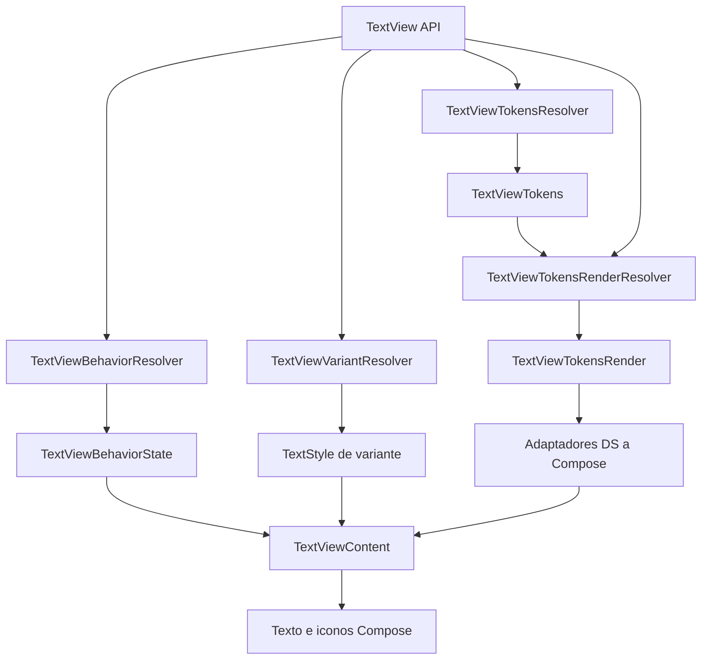

# Arquitectura de TextView

Con TokenBridgeXML, los modelos de `tokens`, `tokensrender`, `variant` y la capacidad de selección de `behavior` viven en `core/components/textviews`. Las rutas públicas de este componente conservan aliases. Su resolver obtiene `LibraryTheme.current` y delega los defaults y el merge al núcleo compartido. El renderer y la interacción Compose siguen en esta carpeta; el wrapper nativo tiene sus adaptadores propios. La guía completa está en `arquitectura-xml-compose/03-textview-implementado.md`.

Este documento describe la implementacion real de `TextView`, el componente Compose de texto del
Design System. Su API representa las capacidades relevantes de un `android.widget.TextView` con un
modelo declarativo: el texto llega como parametro, la apariencia se obtiene de tokens y las
interacciones se expresan con callbacks.

La arquitectura conserva el flujo de `ButtonNavigationMrcy`: API publica, resolucion de tokens,
resolucion de behavior, tokens finales de render y contenido visual. No existe fallback Material ni
un parametro publico que permita reemplazar el objeto completo de tokens.

## Mapa De Carpetas

| Carpeta / Archivo | Tipo | Responsabilidad principal |
| --- | --- | --- |
| `TextView.kt` | API publica / orquestador | Conecta variant, tokens, behavior, tokens render, adaptadores y content. |
| `content/TextViewContent.kt` | Content | Pinta texto e iconos y aplica los valores ya resueltos. |
| `core/components/textviews/tokens/TextViewLayoutTokens.kt` | Core | Centraliza spacing y tamano tactil minimo de iconos. |
| `behavior/TextViewBehavior.kt` | Behavior | Declara si el texto admite seleccion y copia. |
| `behavior/TextViewBehaviorResolver.kt` | Behavior resolver | Crea interacciones independientes y semantica enabled/disabled. |
| `variant/TextViewVariant.kt` | Variant | Declara `DEFAULT` e `HIPERTEXT`. |
| `variant/TextViewVariantResolver.kt` | Variant resolver | Aplica el subrayado propio de `HIPERTEXT`. |
| `tokens/TextViewTokens.kt` | Tokens | Reexporta los contratos compartidos de `core/components/textviews/tokens`. |
| `tokens/TextViewTokensResolver.kt` | Tokens resolver | Lee exclusivamente el tema del DS por variante y aplica overrides. |
| `tokensrender/TextViewTokensRender.kt` | Tokens render | Contiene los valores visuales finales para Content. |
| `tokensrender/TextViewTokensRenderResolver.kt` | Tokens render resolver | Resuelve prioridad normal/error/disabled y colores de iconos. |
| `ui/previews/TextViewPreview.kt` | Ejemplos ejecutables | Presenta los casos principales dentro de `PreviewWrapper`. |

## Flujo Interno



El orden concreto es:

```text
variant + tokensOverride
    -> TextViewTokensResolver
    -> TextViewTokens

behavior + enabled + callbacks
    -> TextViewBehaviorResolver
    -> TextViewBehaviorState

TextViewTokens + enabled + error
    -> TextViewTokensRenderResolver
    -> TextViewTokensRender

TypographyToken + FontFamilyToken + variant
    -> adapters Compose + TextViewVariantResolver
    -> TextStyle final

TextViewTokensRender + TextViewBehaviorState + TextStyle
    -> TextViewContent
```

## Reglas De Capa

| Capa | Puede hacer | No debe hacer |
| --- | --- | --- |
| **Tokens** | Describir color, tipografia, familia e iconos. Fusionar overrides. | Leer Compose, estado o callbacks. |
| **TokensResolver** | Leer los `CompositionLocal` del DS y elegir defaults por variante. | Usar Material, aceptar tokens base externos o resolver gestos. |
| **TokensRenderResolver** | Calcular colores efectivos por estado y transportar tokens finales. | Leer el tema, aplicar modifiers o ejecutar callbacks. |
| **VariantResolver** | Resolver diferencias declarativas entre variantes. | Leer el DS, resolver estados o pintar UI. |
| **Behavior** | Declarar capacidades funcionales. | Representar colores, setters visuales o estado de render. |
| **BehaviorResolver** | Configurar callbacks, gestos independientes y semantica disabled. | Resolver colores, tipografia o iconos. |
| **Core** | Conservar valores comunes de layout y accesibilidad. | Leer el tema o coordinar el componente. |
| **Content** | Renderizar valores finales y aplicar modifiers ya resueltos. | Volver a resolver tokens, variantes o estados. |
| **TextView.kt** | Orquestar todas las capas y convertir tokens a tipos Compose. | Crear defaults visuales o duplicar reglas de resolucion. |

## Tokens Y TokensOverride

`TextViewTokens` contiene un unico modelo para ambas variantes:

| Token | Tipo | Uso |
| --- | --- | --- |
| `textColor` | `ColorToken` | Color normal de texto e iconos. |
| `backgroundColor` | `ColorToken` | Fondo del contenedor. |
| `errorColor` | `ColorToken` | Color de contenido cuando `error = true`. |
| `foregroundColor` | `ColorToken` | Capa dibujada sobre el contenido. |
| `disabledColor` | `ColorToken` | Color de contenido cuando `enabled = false`. |
| `iconStart` | `IconToken?` | Icono inicial opcional. |
| `iconEnd` | `IconToken?` | Icono final opcional. |
| `typography` | `TypographyToken` | Estilo tipografico semantico. |
| `fontFamily` | `FontFamilyToken` | Familia activa del tema. |

La API publica solo acepta `tokensOverride`. Cada campo nullable de
`TextViewTokensOverride` significa "conservar el valor base". `merge()` sigue el patron de
`ButtonNavigationTokens.merge()`:

```kotlin
fun TextViewTokens.merge(override: TextViewTokensOverride?): TextViewTokens {
    if (override == null) return this
    return copy(
        textColor = override.textColor ?: textColor,
        backgroundColor = override.backgroundColor ?: backgroundColor,
        errorColor = override.errorColor ?: errorColor,
        foregroundColor = override.foregroundColor ?: foregroundColor,
        disabledColor = override.disabledColor ?: disabledColor,
        iconStart = override.iconStart ?: iconStart,
        iconEnd = override.iconEnd ?: iconEnd,
        typography = override.typography ?: typography,
        fontFamily = override.fontFamily ?: fontFamily,
    )
}
```

Los iconos base de las dos variantes son `null`. Por eso no hace falta un tipo triestado para
eliminarlos: al recomponer sin un override de icono, el resolver parte otra vez de la base sin icono.
No existe un objeto externo de tokens base que pueda dejar un icono heredado oculto.

## Resolucion Desde La Libreria

`TextViewTokensResolver.resolve()` entrega la biblioteca y variante a `TextViewTokenDefaults.resolve`, que construye la base común y ejecuta `merge(override)`. Obtiene `LibraryTheme.current`, que agrupa los locals activos, y delega defaults a `TextViewTokenDefaults` del núcleo compartido. Si el host no ha instalado el tema del DS, la lectura del color
falla de forma explicita; el componente no disimula esa configuracion con Material.

| Token | `DEFAULT` | `HIPERTEXT` |
| --- | --- | --- |
| `textColor` | `fgDefault` | `linkDefault` |
| `backgroundColor` | `transparent` | `transparent` |
| `foregroundColor` | `transparent` | `transparent` |
| `errorColor` | `fgError` | `fgError` |
| `disabledColor` | `fgSubtle` | `fgSubtle` |
| `typography` | `typography.label` | `typography.label` |
| `fontFamily` | `LocalFontFamily.current` | `LocalFontFamily.current` |
| `iconStart` / `iconEnd` | `null` | `null` |

`HIPERTEXT` agrega subrayado mediante `TextViewVariantResolver`. El DS no define una tipografia
exclusiva de enlace, por lo que conserva `typography.label`. Tampoco agrega un icono ni ejecuta un
click automaticamente: la accion sigue siendo un callback explicito del consumidor. Cuando existe
`onClick`, el modifier publica la accion interactiva y su semantica accesible. La version de Compose
del proyecto no ofrece `Role.Link`; no se sustituye por el rol incorrecto de boton.

## Estados Y TokensRender

`TextViewTokensRenderResolver` es una funcion pura. La prioridad del color de contenido es:

```kotlin
val effectiveContentColor = when {
    !enabled -> tokens.disabledColor
    error -> tokens.errorColor
    else -> tokens.textColor
}
```

| `enabled` | `error` | Color final |
| --- | --- | --- |
| `true` | `false` | `textColor` |
| `true` | `true` | `errorColor` |
| `false` | `false` | `disabledColor` |
| `false` | `true` | `disabledColor` |

El mismo color efectivo se entrega a `iconStart` e `iconEnd`; el modelo solicitado no contiene
colores independientes para iconos. Background y foreground conservan sus tokens resueltos en todos
los estados. TokensRender no contiene callbacks ni logica tactil.

## Behavior E Interacciones

`TextViewBehavior.Default` deja el texto sin seleccion. `TextViewBehavior.Selectable` activa
`SelectionContainer`, por lo que el usuario puede seleccionar y copiar el texto mediante las APIs
nativas de Compose.

`TextViewBehaviorResolver` recibe los callbacks publicos y produce tres interacciones hermanas:

- Texto: click, pulsacion larga y doble click.
- Icono inicial: click y pulsacion larga.
- Icono final: click y pulsacion larga.

El modifier del texto se aplica al nodo `Text`, no al `Row`. Cada icono se renderiza dentro de su
propio `Box` interactivo de al menos `48.dp`. Por ello, tocar un icono no ejecuta `onClick` del texto.
Cuando existe solo click se utiliza `clickable`; cuando existe long click o doble click se utiliza
`combinedClickable`.

Si `enabled = false`, los tres modifiers interactivos se conservan como disabled para accesibilidad,
pero no ejecutan callbacks. El contenedor tambien publica semantica disabled aunque no haya callbacks.

La seleccion comparte long press y doble toque con los gestos de interaccion en Compose. Para que
seleccionar caracteres o palabras sea estable, `textSelectionEnabled = true` reserva ambos gestos y
el resolver no conecta `onLongClick` ni `onDoubleClick` del texto en esa configuracion. Los gestos de
los iconos siguen disponibles. Para usar long click o doble click del texto se utiliza
`TextViewBehavior.Default`.

`combinedClickable` se usa cuando existe un click junto con long click o doble click. Cuando el
consumidor declara exclusivamente long click o doble click, el resolver usa `detectTapGestures` y
publica solo las acciones de accesibilidad reales. La activacion accesible de un callback exclusivo
de doble click ejecuta ese mismo callback porque las APIs semanticas no ofrecen una accion separada
para doble click.

Las descripciones de icono se reciben como `iconStartContentDescription` e
`iconEndContentDescription`. El componente exige texto no vacio cuando el icono es interactivo, por
lo que la aplicacion debe proporcionar una descripcion localizada. Las etiquetas `onClickLabel` y
`onLongClickLabel` pertenecen a las acciones del texto y no se reutilizan como descripciones de
iconos.

## Content

`TextViewContent` recibe tokens de render, colores Compose, el `TextStyle` final y el estado de
behavior. Sus responsabilidades son:

- pintar `Text` con `minLines`, `maxLines`, `overflow` y `textAlign`;
- envolver solo el texto en `SelectionContainer` cuando corresponde;
- omitir por completo cada icono nullable;
- mantener los gestos de los iconos separados del texto;
- aplicar `backgroundColor` antes del contenido;
- dibujar `foregroundColor` como una capa posterior al contenido;
- aplicar tipografia y familia ya convertidas por los adaptadores del DS.

No lee `CompositionLocal`, no calcula estados y no mezcla overrides.

## API Publica

El caso minimo solo requiere `text` y debe ejecutarse dentro de `MyLibraryTheme` o de otro provider
equivalente del DS:

```kotlin
MyLibraryTheme {
    TextView(text = "Cuenta de ahorros")
}
```

### Override Parcial

```kotlin
TextView(
    text = "Texto secundario",
    tokensOverride = TextViewTokensOverride(
        textColor = LocalLibraryColorTokens.current.fgMuted,
        typography = LocalLibraryTypography.current.caption,
    ),
)
```

### Error Y Disabled

```kotlin
TextView(text = "Dato invalido", error = true)

TextView(
    text = "Contenido no disponible",
    enabled = false,
    error = true, // disabled conserva prioridad visual
)
```

### Iconos Del DS

```kotlin
TextView(
    text = "Mas informacion",
    tokensOverride = TextViewTokensOverride(
        iconStart = LocalLibraryIcons.current.alerts.info,
        iconEnd = LocalLibraryIcons.current.arrows.navigateNext,
    ),
    iconStartContentDescription = "Informacion",
    iconEndContentDescription = "Abrir detalle",
)
```

### Interacciones Del Texto

```kotlin
TextView(
    text = "Abrir detalle",
    onClick = { openDetail() },
    onLongClick = { openContextMenu() },
    onDoubleClick = { zoomText() },
    onClickLabel = "Abrir detalle",
    onLongClickLabel = "Mostrar opciones",
)
```

### Interacciones Independientes De Iconos

```kotlin
TextView(
    text = "Documento",
    tokensOverride = TextViewTokensOverride(
        iconStart = LocalLibraryIcons.current.general.link,
        iconEnd = LocalLibraryIcons.current.alerts.info,
    ),
    onClick = { openDocument() },
    onIconStartClick = { copyLink() },
    onIconStartLongClick = { shareLink() },
    onIconEndClick = { showInformation() },
    onIconEndLongClick = { showInformationMenu() },
    iconStartContentDescription = "Enlace del documento",
    iconEndContentDescription = "Informacion del documento",
)
```

### Texto Seleccionable

```kotlin
TextView(
    text = accountNumber,
    behavior = TextViewBehavior.Selectable,
)
```

### HIPERTEXT

```kotlin
TextView(
    text = "Terminos y condiciones",
    variant = TextViewVariant.HIPERTEXT,
    onClick = { openTerms() },
    onClickLabel = "Abrir terminos y condiciones",
)
```

### Lineas Y Overflow

```kotlin
TextView(
    text = description,
    maxLines = 2,
    overflow = TextOverflow.Ellipsis,
    textAlign = TextAlign.Start,
)
```

## Decisiones Arquitectonicas

- No se modifico `ButtonNavigationMrcy`; solo se uso su distribucion de responsabilidades como
  contrato de referencia.
- No existe `tokens: TextViewTokens?` en la API. La base pertenece al DS y la personalizacion es
  siempre parcial mediante `tokensOverride`.
- No existe `fromMaterial()` ni `hasLibraryTokens()`.
- No hay setters visuales en Behavior. Texto, colores, fondo, tipografia y lineas son propiedades
  declarativas.
- Los iconos forman parte de tokens para que el host use `IconToken` del DS. Ninguna variante los
  muestra por defecto.
- `HIPERTEXT` reutiliza roles semanticos existentes (`linkDefault` y `label`) en lugar de inventar
  tokens.
- La prioridad disabled sobre error vive una sola vez en TokensRenderResolver.
- El foreground se aplica al final del dibujo, equivalente a una capa superior de un TextView XML.
- El texto y cada icono tienen nodos de interaccion separados para impedir propagacion accidental.

## Verificacion

`TextViewArchitectureTest` valida el merge parcial, los tres estados visuales, la prioridad disabled,
los colores de iconos y la resolucion de variantes. `TextViewInteractionTest` cubre, en pruebas
instrumentadas Compose, click/long click/doble click, independencia de ambos iconos, bloqueo disabled
y ausencia de accion click en el caso basico.

## Paridad con XML

La implementación nativa consume los mismos contratos de `core/components/textviews`. `TextViewLayoutTokens` centraliza separación de 8dp, celda interactiva de 48dp y límites de líneas; `InteractionSpacings` aporta el mínimo interactivo global. Compose conserva su distribución de referencia. La galería XML reproduce los nueve casos de `TextViewGalleryPreview` y comparte sus strings. Ver [contrato y validación](../../../../../../../../../../arquitectura-xml-compose/07-paridad-textview-compose-xml.md).
